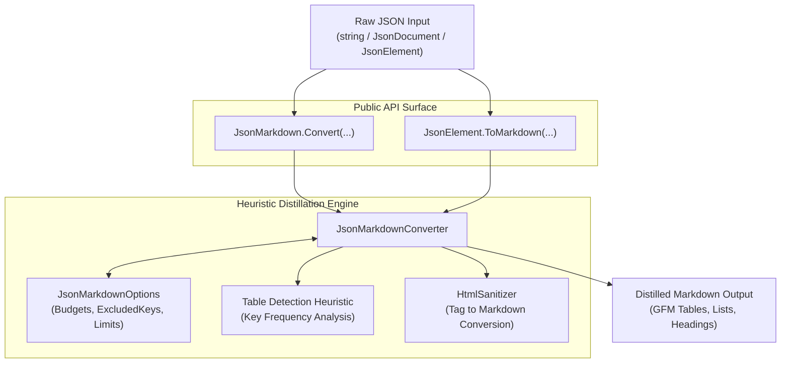

# Architecture & Technical Design

This document details the architectural principles, component responsibilities, and implementation design for the **`JsonToMarkdown`** library.

---

## 1. System Overview

`JsonToMarkdown` is a zero-dependency, high-throughput .NET library designed to distill raw, verbose JSON payloads from REST APIs into token-efficient GitHub Flavored Markdown (GFM) for AI models (LLMs, agents, MCP servers).



---

## 2. Project Boundaries & Responsibilities

| Component | Target Frameworks | Responsibility |
| :--- | :--- | :--- |
| **`JsonToMarkdown`** | `net8.0`<br>`net9.0`<br>`net10.0` | Core library: heuristic conversion engine, options, HTML translation, table detection. **Zero 3rd-party dependencies**. |
| **`JsonToMarkdown.Tests`** | `net9.0`<br>`net10.0` | Comprehensive unit tests across primitive formatting, GFM tables, HTML parsing, noise pruning, and real-world API schemas (Azure DevOps, GitHub, Stripe). |

---

## 3. Core Heuristics & Conversion Engine

### A. Automatic GFM Table Detection
Arrays of objects are analyzed before rendering:
1. **Candidate Verification**: Array length $\ge \text{MinTableRows}$ (default: 2), and elements are `JsonValueKind.Object`.
2. **Column Frequency Sampling**: Evaluates scalar properties (`string`, `number`, `boolean`) across up to `MaxArrayItems`.
3. **Column Selection**: Properties appearing most frequently are selected as table columns (up to `MaxTableColumns`, default: 8).
4. **Cell Normalization**: Cell values escape pipe `|` characters (`\|`) and replace newlines with single spaces to maintain valid Markdown table syntax.

### B. Smart Noise Filtering
Many enterprise APIs include internal metadata that wastes tokens:
* Property keys matching `ExcludedKeys` (e.g. `_links`, `etag`, `watermark`, `__v`) are discarded by default.
* Comparison is performed via an allocation-free case-insensitive `HashSet<string>`.

### C. Rich Text / HTML Sanitization
Ticketing and issue systems (Jira, Azure DevOps, Zendesk) store descriptions as rich HTML.
* `HtmlSanitizer` detects and transforms HTML structures:
  * `<p>`, `<div>` $\rightarrow$ double/single newlines
  * `<b>`, `<strong>` $\rightarrow$ `**bold**`
  * `<i>`, `<em>` $\rightarrow$ `*italic*`
  * `<code>` $\rightarrow$ `` `code` ``
  * `<pre><code>` $\rightarrow$ ```` ```code``` ````
  * `<li>` $\rightarrow$ `* list item`
  * `<a href="...">` $\rightarrow$ `[text](url)`
  * Strips residual tags and decodes HTML entities (`&nbsp;`, `&amp;`, `&lt;`, `&gt;`).

### D. Hard Token & Budget Guards
To prevent context overflow from malicious or massive payloads:
* `MaxArrayItems`: Caps rows rendered, appending `*... and N more rows*`.
* `MaxStringLength`: Truncates individual strings exceeding the threshold with `... *(truncated)*`.
* `MaxDepth`: Prevents stack overflow or runaway recursion on deeply nested JSON objects.

---

## 4. Performance & Invariants

* **Zero External Dependencies**: Built entirely on built-in `System.Text.Json` and `System.Memory`.
* **Native AOT Compatible**: No reflection-based serialization; operates directly on `JsonElement` and `Utf8JsonReader`.
* **Central Package Management (CPM)**: Enabled globally via `Directory.Packages.props`.

---

## 5. Extensibility Roadmap

1. **Fluent Mapping DSL**: Allow developers to register declarative templates for known schemas (e.g., custom headers, badge formatting).
2. **`Utf8JsonReader` Direct Streaming**: Stream directly from `Stream` or `PipeReader` without parsing into an intermediate `JsonDocument`.
3. **TikToken / Token Estimator**: Built-in estimation of token savings (e.g. reporting "reduced from 1,200 to 110 tokens").
